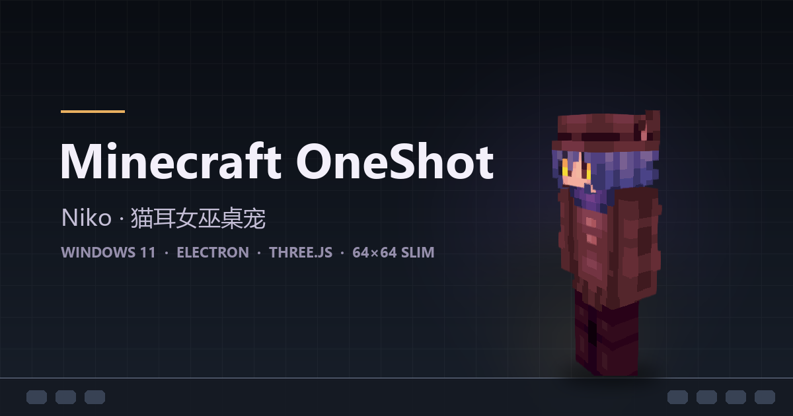
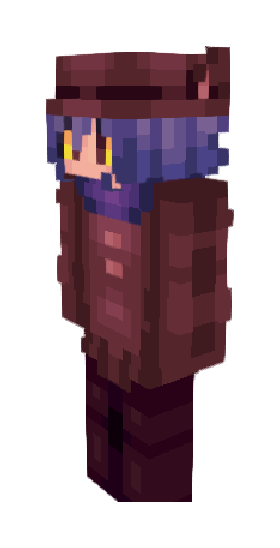

# Minecraft OneShot 桌宠

<p align="center">
  
</p>

<p align="center">
  
  
  
  
</p>

一个慵懒的 OneShot × Minecraft 风格 3D 桌宠：把 **64×64 Slim 双层皮肤**实时渲染成可动的 3D 角色——Niko，《OneShot》里那只猫耳女巫。她待在 Windows 11 任务栏上方，散步、眨眼、东张西望、坐下打盹、伸懒腰、掏面包啃、屏幕变暗时举起火把。

- 角色永久固定为 **64×64 Minecraft Slim 双层皮肤**，保留像素外观、贴图 UV 与内外层结构，只在此基础上叠加骨骼与次级动作。
- 桌面上**没有任何文字、气泡或名字牌**；显示/隐藏、设置、拍照、退出都在托盘和设置窗口里。
- 窗口**透明、无边框、置顶**，空白像素点击穿透，不抢焦点、不挡操作。
- 单击摸头、按下压扁、长按切火把、再按住就化成紫色末影粒子消失——手感对齐「鲸鱼娘」桌宠。

---

## 角色

<p align="center">
  
</p>

- 皮肤固定为 **64×64 RGBA、Slim（3px 手臂）、双层**，Three.js + skinview3d 按原贴图 UV 渲染，保留内外层结构，不改贴图、不替换模型。角色是《OneShot》的 Niko，模型按 Minecraft 皮肤格式重绘。
- 固定 3/4 视角，走路时轻微转身；呼吸、眨眼、头部跟随鼠标、四肢摆动都只叠加在原有像素模型上。
- 桌宠窗口不绘制任何文字、气泡或名字牌，调试信息只写日志。

---

## 目录

- [角色](#角色)
- [它会做什么](#它会做什么)
- [操作与快捷键](#操作与快捷键)
- [快速开始](#快速开始)
- [素材说明](#素材说明)
- [目录结构](#目录结构)
- [技术栈](#技术栈)
- [当前状态与已知限制](#当前状态与已知限制)
- [文档](#文档)
- [许可与免责声明](#许可与免责声明)

---

## 它会做什么

### 互动

| 操作 | 表现 |
|---|---|
| 单击 | 摸头：歪头、闭眼、冒粉色爱心粒子、打呼噜 |
| 按下 | 以脚底为轴压扁（`scaleX 1.05` / `scaleY 0.88`），播放 `Ya1` |
| 松开 | 220ms 弹性回弹（`cubic-bezier(.34,1.56,.64,1)`），播放 `Ya2` |
| 按住 ≥250ms 后拖动 | 拖拽角色，可跨显示器；透明窗口允许移出屏幕边缘，但角色本体始终保持可见，松手保留位置 |
| 原地按住 1.5s | 切换火把（点燃 / 熄灭音效） |
| 继续按住 2.4s | 紫色末影粒子开始在角色周围聚集 |
| 按住 3.0s | 关闭：粒子爆发，停留约 1.2s 后隐藏到托盘 |
| 右键角色 | 打开设置窗口 |
| 托盘菜单 | 显示 / 隐藏宠物、设置、拍照、退出 |

### 自主行为

- **待机**：呼吸起伏、眨眼、偶尔东张西望、头部跟随鼠标。
- **散步**：在任务栏上方左右走动，手臂与腿反向摆动，脚步声、到屏幕边缘转身。
- **坐下 / 打盹 / 睡觉**：久坐后身体放低、腿前伸；空闲时间达到阈值后闭眼、低头、慢呼吸，点击或快捷键叫醒。
- **伸懒腰**：睡醒或随机触发，双臂上举、身体后仰、仰头。
- **啃面包**：掏出 Minecraft 面包啃几口，掉面包屑、咀嚼音、打嗝、冒爱心。
- **挥手 / 跳舞 / 转圈**：低频随机小动作，也可以在托盘或快捷键手动触发。
- **火把**：屏幕亮度低于阈值时自动举火把，暖光照亮角色和周围地面，火星粒子；手动可随时切换。
- **全屏探头**：检测到前台全屏程序时把身体藏到屏幕外，偶尔从随机边缘探头；退出全屏恢复底部散步。

### 系统集成

- 托盘常驻，支持开机自启（写入当前用户 `Run` 项，不请求管理员权限）。
- 单实例运行：重复启动只会唤起已有宠物。
- 全局快捷键（默认 10 个，全部可在设置里清空或改键）。
- `Ctrl+Alt+P` 拍照：冻结当前姿态、连桌面背景一起截图，保存到 `图片\NikoPet`，可按当前屏或每屏一张。
- 设置窗口 6 个分类：**外观与声音、自主行为、特效与性能、启动与照片、互动与环境、全屏探头**。
- 设置页可调：角色大小（80–500px）、透明度、音量与静音、点击/动作音效、活跃度与随机动作、散步开关/频率/速度、睡眠开关与时长、性能档（简朴/普通/华丽）、阴影、粒子、待机微动、开机自启、自启时隐藏、照片目录与文件名前缀、亮度阈值、全屏探头频率、快捷键。

---

## 操作与快捷键

### 鼠标手势

见上方[互动](#互动)表格。要点：

- **单击** = 摸头，**按住不动** = 火把 / 关闭，**按住并移动** = 拖拽；
- 按住超过 1.5s 后再移动不会进入拖拽，避免误操作；
- 透明区域的鼠标事件直接穿透到桌面。

### 全局快捷键（默认值）

| 动作 | 默认快捷键 |
|---|---|
| 显示 / 隐藏 Niko | `Ctrl+Alt+Shift+N` |
| 拍照 | `Ctrl+Alt+P` |
| 打开设置 | `Ctrl+Alt+Shift+S` |
| 喂面包 | `Ctrl+Alt+Shift+F` |
| 摸头 | `Ctrl+Alt+Shift+M` |
| 切换火把 | `Ctrl+Alt+Shift+T` |
| 跳舞 | `Ctrl+Alt+Shift+D` |
| 挥手 | `Ctrl+Alt+Shift+W` |
| 睡觉 | `Ctrl+Alt+Shift+Z` |
| 叫醒 | `Ctrl+Alt+Shift+Q` |

快捷键可在设置窗口底部的「快捷键」区域修改（Electron 加速键格式，清空即禁用）；被系统或其他软件占用时会提示失败。

---

## 快速开始

### 环境要求

- **Windows 11 x64**
- **Node.js 24**（或 ≥ 22）与 **pnpm 11**
- 运行本身不需要 Minecraft 客户端：皮肤、音效、贴图已随仓库提供（见[素材说明](#素材说明)）

### 运行

```bash
git clone https://github.com/lisuotian2-svg/minecraft-niko-desktop-pet.git
cd minecraft-niko-desktop-pet
pnpm install
pnpm dev        # 开发模式（热更新）
```

### 构建与测试

```bash
pnpm build      # electron-vite 构建到 out/ + TypeScript 类型检查
pnpm preview    # 用构建产物启动
pnpm test       # Vitest 单元测试（11 个文件 / 83 项）
pnpm typecheck  # 只做类型检查
```

> **Electron 固定 44.7.0。** 更高版本在本机 Windows 11 26200 上会出现 `app.whenReady` 不触发的启动挂起，请勿升级 `electron` 依赖。

---

## 素材说明

| 路径 | 内容 | 授权 |
|---|---|---|
| `public/assets/skin/niko.png` | 64×64 RGBA、Slim（3px 手臂）、双层 | 项目所有者提供的贴图（角色 Niko 来自《OneShot》） |
| `public/assets/vanilla/sounds/**` | Minecraft Java 1.20.1 原声（脚步、猫呼噜、咀嚼、火把、末影、点击……） | © Mojang Studios / Microsoft，非 MIT |
| `public/assets/vanilla/textures/**` | 面包、火把、爱心、火焰、粒子贴图 | © Mojang Studios / Microsoft，非 MIT |
| `public/assets/whale/Ya1.mp3`、`Ya2.mp3` | 按下 / 松开点击音 | 来自 `dsh-whale-widget`，as-is，非 MIT |
| `public/assets/icon/*.ico` | 由皮肤头部生成的托盘与窗口图标 | 本项目派生 |
| `public/assets/animations/**` | 开场动画资源位（暂未启用） | 本项目 |

- 需要从自己的 Minecraft 安装重新提取原声与贴图（需要已安装 Java 1.20.1 客户端）：

  ```powershell
  pwsh tools/extract-vanilla.ps1
  ```

  脚本会读取 `%APPDATA%\.minecraft` 的 `assets/indexes/5.json` 与客户端 jar，把音效和贴图写回 `public/assets/vanilla/`，并生成不带本机绝对路径的 `ASSETS.json` 清单。

- 只想要代码、不想要第三方素材：删除 `public/assets/vanilla/`、`public/assets/whale/`，再自行放入同名的自有素材即可；`public/assets/skin/niko.png` 是 3D 模型必需的皮肤。

详见 [docs/ASSETS.md](docs/ASSETS.md) 与 [NOTICE.md](NOTICE.md)。

---

## 目录结构

```
src/
  main/       Electron 主进程：透明窗口、托盘、全局快捷键、拍照、全屏检测、开机自启、设置存储
  preload/    contextBridge 暴露的 PetApi（主进程 ⇄ 渲染进程）
  renderer/   Three.js 角色渲染、动画状态机、手势、音频、粒子、设置页
  shared/     纯逻辑：设置 schema、手势状态机、行走边界、拖拽、弹性、爱心、频率
tests/        Vitest 单元测试
tools/        截图、CDP 调试、素材提取脚本
native/       C# 全屏检测辅助进程（缺失时回退到 PowerShell 动态编译）
public/       皮肤、音效、贴图、图标
docs/         需求、技术方案、决策记录、素材清单、QA 与开发记录
```

---

## 技术栈

| 层 | 选型 |
|---|---|
| 运行时 | Electron **44.7.0**（固定，见上） |
| 3D / 渲染 | Three.js 0.156.1 + skinview3d 3.4.2（Slim 双层皮肤模型、固定 3/4 视角） |
| 语言 | TypeScript 5.9，`strict`，纯逻辑集中在 `src/shared` |
| 构建 | electron-vite 6 + Vite 8 |
| 测试 | Vitest 5：11 个测试文件 / 83 项（手势、行走、拖拽、弹性、设置存储与迁移、爱心、拍照、探头频率） |
| 全屏检测 | C# 辅助进程 `native/fullscreen-watcher`，可回退 PowerShell + `Add-Type` |
| 打包 | 暂未包含 electron-builder 配置，目前只提供源码运行 |

设计取舍见 [docs/DECISIONS.md](docs/DECISIONS.md)，实现方案见 [docs/TECH-PLAN.md](docs/TECH-PLAN.md)。

---

## 当前状态与已知限制

- **仅 Windows**：托盘、透明窗口、全屏检测、开机自启都依赖 Win32 / Electron 的 Windows 行为。
- **没有发布二进制**：仓库不含 `electron-builder` 配置与安装包；想分发请自行加打包脚本。
- **部分功能只做过逻辑与截图验证**：全屏探头、托盘退出、开机自启、多屏拍照尚未完成系统级实机验收，遇到问题欢迎开 issue。
- **Electron 锁定 44.7.0**：升级会导致本机启动挂起。
- 皮肤、音效、贴图是第三方素材，公开再分发前请先看 [NOTICE.md](NOTICE.md)。

---

## 文档

- [产品需求（PRD）](docs/PRD.md)
- [技术方案](docs/TECH-PLAN.md)
- [问答与决策记录](docs/DECISIONS.md)
- [素材来源与许可](docs/ASSETS.md)
- [M0 技术验证报告](M0-REPORT.md) · [M1 阶段报告](M1-REPORT.md)
- 开发记录：[交接说明](docs/CODEX-LATEST-HANDOFF.md)、[QA 基线](docs/QA-BASELINE.md)、[设置页 QA](docs/QA-SETTINGS-V2.md)、[团队交接](docs/TEAM-HANDOFF.md)

---

## 许可与免责声明

- **代码**：MIT，见 [LICENSE](LICENSE)。
- **素材**：Minecraft 音效与贴图 © Mojang Studios / Microsoft，**不在 MIT 授权范围内**；Niko 角色来自游戏《OneShot》，版权归其创作者（Future Cat LLC）所有，皮肤贴图由项目所有者提供；`dsh-whale-widget` 的点击音效按原插件 as-is 提供，不可再许可。第三方素材清单与来源见 [NOTICE.md](NOTICE.md)。
- 本项目是**非官方**的个人作品，与 Mojang Studios、Microsoft、Future Cat LLC、DeepSeek 均无关联，也未获其背书。
- Minecraft 素材仅用于个人、非商业的桌宠展示；如果你要公开分发、商用或做衍生发布，请先替换为自有素材，或取得权利方许可。
- 若权利方认为本仓库内容不当，请通过 issue 联系，我会立即移除相关素材。
